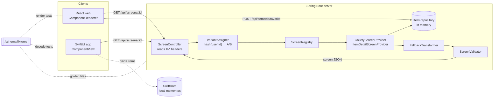

# momento

a digital place for your trinkets, knick-knacks, and keepsakes :D

Point your camera at something, tap it, and Momento lifts it out of the
background using on-device Vision, with no AI API costs.

This repo also holds a **server-driven UI (SDUI)** system for Momento. A Java
service decides what each screen looks like and sends it as JSON. A React web
client and the SwiftUI app both render that JSON natively, so a layout change
on the server reaches every client without shipping a new client build.

## Architecture



Each `GET /api/screens/{id}` runs one pipeline:

1. **Context.** `ScreenController` reads the client's headers into a `ClientContext` and picks a layout variant.
2. **Build.** `ScreenRegistry` finds the `ScreenProvider` for the id. The provider builds a typed component tree plus the `data` its bindings point at.
3. **Adapt.** `FallbackTransformer` rewrites any component the client didn't list as supported.
4. **Check.** `ScreenValidator` checks the serialized JSON against the contract before it is sent.

## Repo layout

```
/Momento   the iOS app (xcodegen)
/ios       MomentoSDUI Swift package: models, renderer, client
/server    Java 21, Spring Boot 3, Maven
/web       React 18, TypeScript, Vite
/schema    shared JSON fixtures, used by server, web and iOS tests
/.github   CI for server and web
```

## Schema reference (v1)

A screen is a component tree plus the data it binds to:

```json
{
  "schemaVersion": 1,
  "screenId": "gallery",
  "title": "My keepsakes",
  "data": { "count": 8, "items": [{ "id": "1", "title": "Ticket stub", "imageUrl": "…", "year": 2016, "favorite": true }] },
  "root": { "type": "column", "id": "root", "children": [ … ] }
}
```

Every component has a `type` and a unique `id`. Required fields are checked by
`ScreenValidator`.

| Type     | Props                                       | Other fields                   |
| -------- | ------------------------------------------- | ------------------------------ |
| `column` | `spacing?`                                  | **`children`**, `action?`      |
| `row`    | `spacing?`                                  | **`children`**, `action?`      |
| `text`   | **`text`**, `style?` (`title` `headline` `body` `caption`) |                 |
| `image`  | **`url`**, `alt?`, `aspectRatio?`           |                                |
| `card`   | **`title`**, `imageUrl?`, `subtitle?`       | `action?`                      |
| `grid`   | **`columns`**, **`itemsBinding`**           | **`template`**                 |
| `list`   | **`itemsBinding`**                          | **`template`**                 |
| `button` | **`label`**, `style?` (`primary` `secondary`) | **`action`**                 |
| `spacer` | **`size`**                                  |                                |

**Actions**

| Type       | Fields                                   | Client behaviour                                 |
| ---------- | ---------------------------------------- | ------------------------------------------------ |
| `navigate` | **`screenId`**, `params?`                | Route to `/screens/{screenId}?{params}`          |
| `request`  | **`method`**, **`path`**, `refresh?`     | Call `path` on the server, then re-fetch the screen if `refresh` is set |

**Bindings.** Any string in `props` or an action can contain `{{path}}`. Paths
are dotted and can index arrays (`items.0.title`). They resolve against the
screen's `data`. Inside a `grid` or `list` template, `item` is the current
element of the array at `itemsBinding`. A string that is exactly one binding
resolves to the raw value; otherwise values are interpolated as text.

**Request headers**

| Header                   | Example                     | Default if missing |
| ------------------------ | --------------------------- | ------------------ |
| `X-User-Id`              | `web-demo-user`             | `anonymous`        |
| `X-Platform`             | `web` / `ios`               | unknown            |
| `X-Schema-Version`       | `1`                         | `1`                |
| `X-Supported-Components` | `column,text,list,…`        | all v1 types       |

Responses carry `X-Variant: A|B`. Add `?variant=A` or `?variant=B` to force a variant.

**Other endpoints:** `GET /api/items`, `POST /api/items/{id}/favorite` (toggles), `GET /api/health`.

## Running it

**Server** (needs JDK 21 and Maven):

```bash
cd server
mvn spring-boot:run          # http://localhost:8080
mvn verify                   # tests
mvn test -Dtest=ScreenFixtureTest -DupdateFixtures=true   # regenerate /schema fixtures after a deliberate layout change
```

**Web** (needs Node 20+). Start the server first.

```bash
cd web
npm install
npm run dev                  # http://localhost:5173
npm test && npm run lint && npm run typecheck
```

Set `VITE_API_BASE` to point at a server other than `http://localhost:8080`.
Open **Dev panel** in the header to change the user id, force a variant, or
untick component types. The page re-fetches as you change them. Untick `grid`
and `card` to watch the server fall back to a list of image-and-text columns.

**iOS**

Requires Xcode 15+, iOS 17+, and [xcodegen](https://github.com/yonaskolb/XcodeGen) (`brew install xcodegen`).

```bash
xcodegen generate
open Momento.xcodeproj
```

In Xcode, open target `Momento` → Signing & Capabilities and pick your team.
Subject Lifting needs a real iPhone.

To open the server-driven gallery, edit the Momento scheme → Run → Arguments
and tick `-SDUIGallery YES`. It reads the server URL from `SDUIBaseURL` in
`Momento/Info.plist`. The default, `localhost:8080`, works in the simulator; on
a device, use your Mac's LAN address. The renderer package has its own tests:

```bash
cd ios && swift test
```

## Design decisions

**Why fallback happens on the server.** Clients only say *what* they can
render. They don't say how to degrade. Keeping the rewrite rules
(`grid → list`, `card → column[image, text]`, `row → column`) on the server has
three benefits:

- Every client gets the same degradation, so web and iOS can't drift apart.
- A rule can be added or changed without a client release. That matters most
  for old clients, which are the ones that need fallbacks and can't be updated.
- The validator runs *after* the rewrite, so fallback output is held to the
  same contract as everything else.

If no chain of rules reaches a supported type, the original node is sent
unchanged. The client's unknown-type placeholder then names what the server
meant to show, instead of failing silently.

**Why bindings instead of baked data.** Providers emit a template plus `data`
rather than one card per item with the values filled in. This does three things:

- Layout and content stay separable. The iOS gallery uses the server's layout
  but swaps `data.items` for the phone's own SwiftData mementos, so photos never
  leave the device.
- A 100-item grid is one template, not 100 copies of the same subtree.
- The validator can prove every `{{item.x}}` exists on every element before the
  screen is sent.

**How variants are bucketed.** `VariantAssigner` hashes
`"gallery-layout:" + userId` with SHA-256 and takes the first four bytes modulo
100. Buckets below 50 get variant A (two-column grid). The rest get B
(single-column list with larger images).

- **Stable.** Assignment is a pure function of the id, so a user sees the same
  layout on every request, restart and server instance with nothing stored.
- **Independent.** The experiment-name salt keeps future experiments
  independent of this one.
- **Adjustable.** Percentage buckets make a 10/90 rollout a one-number change.

Tests pin known buckets so an accidental hash change, which would silently
reshuffle every user, fails CI.

**Other choices**

- **Typed tree, JSON validation.** The server models components as a sealed
  interface with one record per type, so pattern-matching `switch`es
  (fallback, `type()`) are exhaustive at compile time. The validator, however,
  checks the *serialized JSON*: it sees exactly what clients receive and can
  also check hand-written fixtures.
- **One set of fixtures.** `/schema/fixtures` is the contract. The server
  asserts its output matches them exactly, the web tests render them, and the
  Swift tests decode them. A schema change that breaks one client fails a test.
- **Clients never crash on the unknown.** An unknown or malformed component
  renders a visible placeholder and logs a warning, and the rest of the screen
  still works. On iOS, a known type with a missing prop degrades the same way
  instead of failing the whole decode.

## Status

- ✅ Camera, tap-to-lift (`VNGenerateForegroundInstanceMaskRequest`), SwiftData persistence
- ✅ SDUI: Java server, React renderer, SwiftUI renderer, CI
